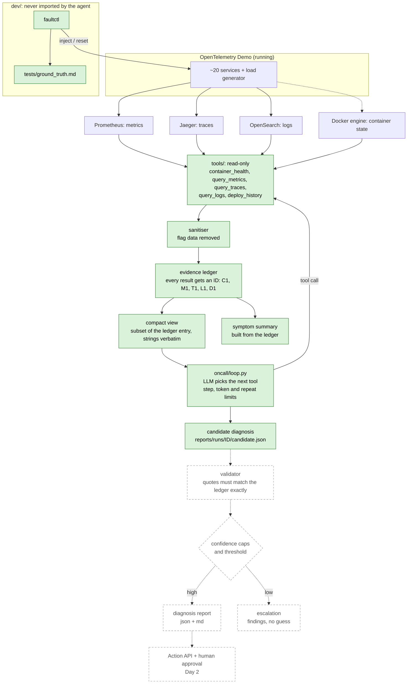

# Incident Zero: architecture (Day 1)

An AI on-call engineer for the OpenTelemetry Demo. It is given a symptom, investigates with
read-only tools, and proposes a root cause with evidence and a confidence. Day 1 is read-only
and ends at a **candidate** diagnosis; validation, confidence caps, escalation and reports are
planned, not built.

Solid green = built and tested. Dashed grey = planned (P6 and Day 2), not in the code yet.

## Components

| Part | Where | What it does |
|---|---|---|
| Tools | `tools/` | Five read-only functions. Each returns one result shape with three states: `data`, `no_data`, `backend_error`. An error or an empty answer is never reported as healthy. |
| Sanitiser | `tools/sanitize.py` | Removes feature-flag data from every result before anyone sees it. The only file that names the flag service. |
| Ledger | `tools/ledger.py` | Stores each sanitised result under an ID (`C1`, `M2`, ...). Saved as `ledger.json` with every run. |
| Tool box | `oncall/toolbox.py` | Turns each tool's typed signature into a JSON schema, checks the model's arguments, and builds the compact view the model is shown. |
| Loop | `oncall/loop.py` | The tool-calling loop and its budgets. |
| LLM adapter | `oncall/llm.py` | One interface over the Anthropic SDK (or any OpenAI-compatible one). Reports token usage. |
| Prompt | `oncall/prompts.py` | Generic on-call guidance. No faults, flags or service behaviours. |
| CLI | `oncall/investigate.py` | `python -m oncall.investigate [--summary]`; after saving the run it calls `finalize` to write `report.json` and `report.md` into the run folder, and `investigate(symptom)` returns the report dict. |
| Fault injector | `dev/faultctl/` | Creates practice incidents and logs ground truth. Separate package, never imported by `oncall/` or `tools/`. |

## The tools

| Tool | Source | Shows |
|---|---|---|
| `container_health` | Docker | Status, health, restarts, exit code, OOM, CPU, memory. The only way to see a stopped container. |
| `query_metrics` | Prometheus | Per-service request rate, error rate, p95 latency, top erroring spans. |
| `query_traces` | Jaeger | Real trace IDs, root service, and the deepest erroring span (where an error starts). |
| `query_logs` | OpenSearch | Top error lines, verbatim, grouped, with counts and first/last seen. |
| `deploy_history` | Docker | Container start and restart times. |

## How the agent decides

1. The model starts with the symptom text and the tool list. Nothing is pre-loaded.
2. Each turn it picks one tool and arguments. The loop runs it, stores the full result in the ledger, and shows the model a **compact view**: counts and only the abnormal rows, with every string and number copied unchanged from the ledger entry.
3. The next tool is chosen from the findings so far. The step list records each call, a one-line finding built from the result, and the ledger ID.
4. The model ends by calling `submit_diagnosis`: component, cause, stated confidence, evidence (ledger ID plus an exact quote), alternatives and limitations. "unknown" with low confidence is a valid answer. A diagnosis that names a component but cites no evidence is sent back once; if it is still empty it is kept and the gap is recorded in `limitations`. Query windows are capped at 30 minutes (the cap is recorded on the step when it applies).
5. Limits: 12 tool calls, 200,000 tokens (input + output), a small token cap per reply, and a stop on an identical repeated call. A reserve keeps room to conclude: at 85% of the tokens, or with one tool call left, the model is told to call `submit_diagnosis` now using only evidence it has already seen. If it still cannot, the candidate is an explicit `unknown` with confidence 0 and the reason, never an invented diagnosis. The concluding call and any retry of a rejected submission get a larger reply cap (4,000 tokens, never more than the budget has left); a rejected submission cut off by the cap is reported as cut off and retried with a request for a shorter answer. Every rejected submission is saved as it arrived in `rejected_submissions.json`.

## Safety controls

| Control | Status |
|---|---|
| Read-only: tools only run queries and `docker ps`, `inspect`, `stats`. There is no tool that changes anything. | Built |
| Flag isolation: the sanitiser strips flag attributes, flag-evaluation spans and the flag services' logs, metrics and containers. Tests scan tool output and everything sent to the model for flag names. | Built |
| The agent never sees the injected incident: the symptom is generic, `oncall/` cannot import `dev/` (tested), and the run ID is generated by the run. | Built |
| Evidence ledger: every result the model can quote is stored with an ID. | Built |
| Budgets: tool calls, tokens, repeats, LLM timeouts and malformed answers all end in a recorded partial result. | Built |
| Validator: every cited ID must exist and every quote must match the ledger exactly. | Planned (P6) |
| Confidence caps and escalation to a human below a threshold. | Planned (P6) |
| Action API, dry run, kill switch and human approval before any change. | Planned (Day 2) |

## Hands

- Flow (`python -m actions.run_incident --alert TEXT`): investigate, propose one action, show it and ask a human, execute, verify, write `incident_report.md/json` into the run folder. `detector/detect.py` watches the shop and starts this flow with a generic alert text.
- Allowlist: one action, `restart_container` (`docker start` for a stopped container, `docker restart` otherwise). The command is built from the container's current state and re-checked just before it runs. The deny list is the monitoring stack (`jaeger`, `prometheus`, `opensearch`, `otel-collector`, `grafana`, `kafka`, `frontend-proxy`) plus the flag service containers, which are refused by the sanitiser.
- Dry run is the default: an approved action only changes something when `--execute` is given. Only an explicit "y" or "yes" approves; no terminal, EOF or any other answer is a denial. One action per incident.
- Kill switch: the file `reports/actions/KILL` (`python -m actions.kill on|off|status`). While it exists nothing is approved or executed, and it is checked again right before the command.
- Audit log: `reports/actions/audit.jsonl`, append-only, one JSON line per approval, dry run, execution and kill switch change.
- Verification is read-only: the container must be running and healthy; metrics (the load generator ignored) then decide `recovered` or `recovered_unverified_metrics`. A container that never becomes healthy is `not_recovered`, and a restart has nothing to roll back, so that case goes to a human.
- Not in v1: toggling a feature flag, Kubernetes scaling, load-generator throttling, automatic rollback.

## Known limits

- The candidate is **not validated**. The model's quotes are not yet checked against the ledger.
- The symptom summary is built from the ledger without a second model call. It lists what the tools showed and does not name a cause.
- `deploy_history` is only container start times. After `make start` every container looks recently started, so it says little.
- Token counts for the budget come from the provider; cache reads count in full.
